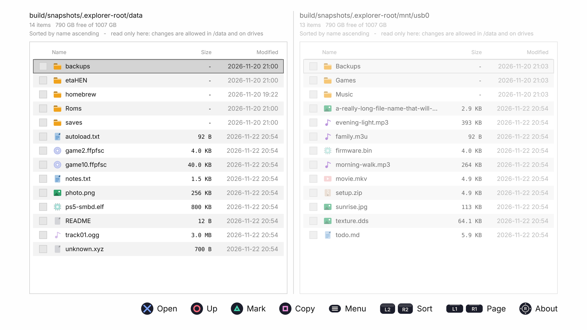
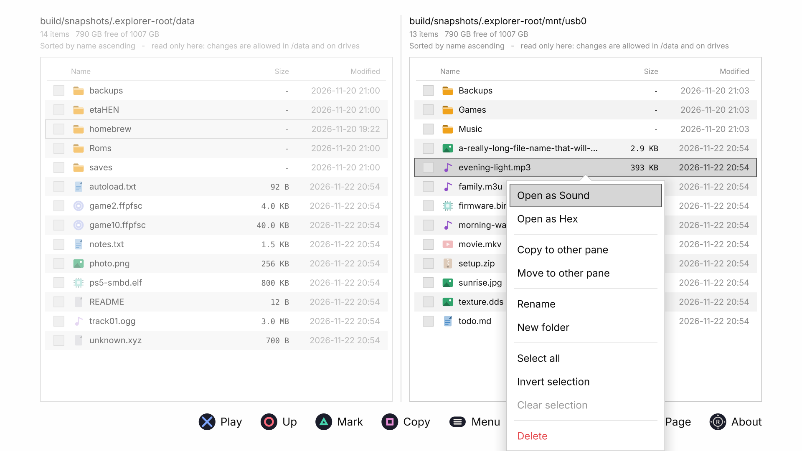
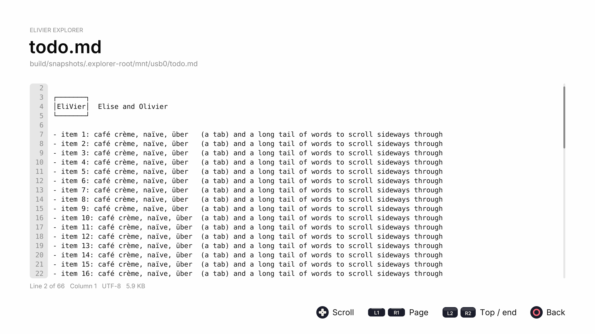
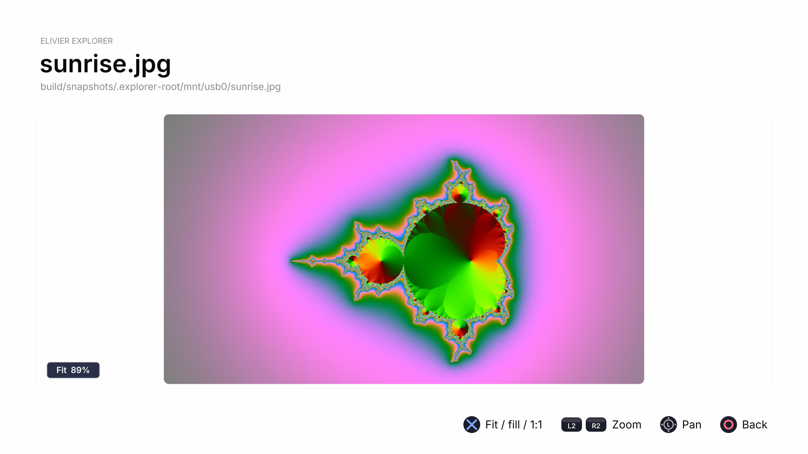
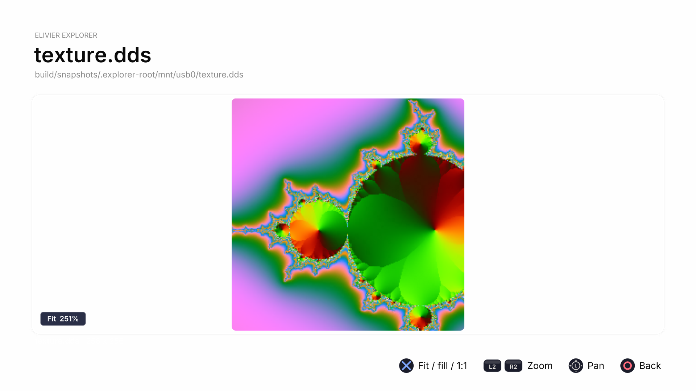
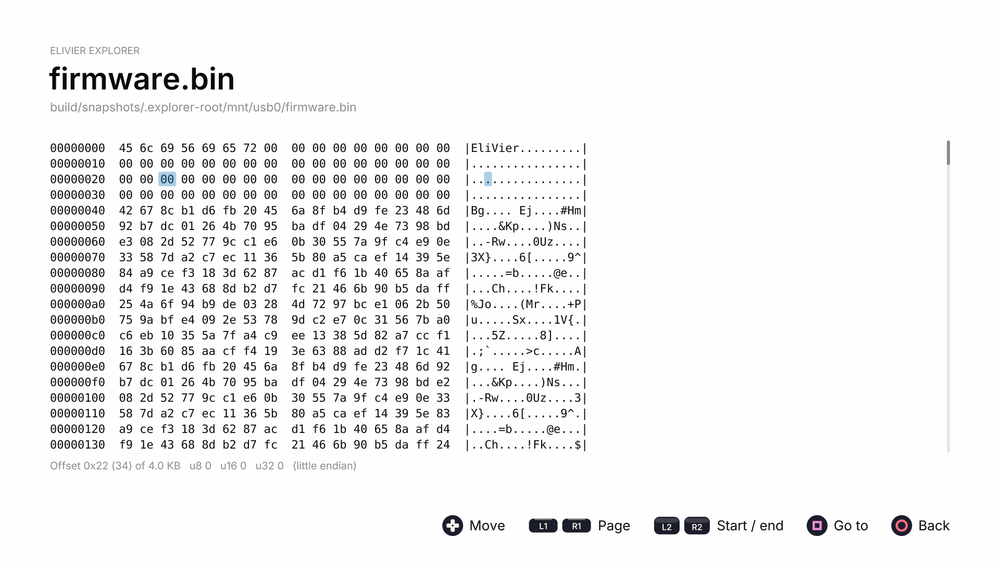
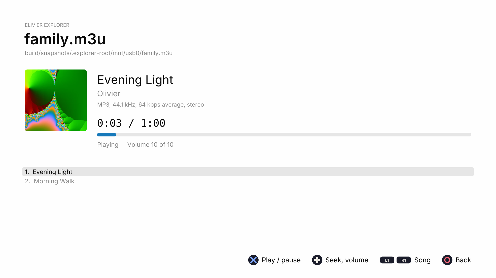

[](https://ko-fi.com/H5L629ZHNX)

# EliVier Explorer

A file explorer for the PS5 (`LAPY69432`), made for the controller and the television. Two panes, copy, move and
delete that are hard to get wrong, and built-in viewers: text, pictures (also DDS), a hex view and an MP3 player
with playlists.

I made it because the file explorers I tried were not pleasant to use, or were buggy (one wiped a whole USB
drive). This one aims at comfort and at **opening files**, and it will grow: loading payloads, more file types and
ShadowMount integration are on the list.

**Status:** first version, tested on one PS5. The Files screen, the copy, move and delete jobs (including a
cancelled 23 GB move), and the text, image, hex and MP3 viewers have been used on a console. Not yet tried on a
console: a name conflict while copying, deleting a big folder, a file over 4 GB onto an exFAT or FAT32 drive, and
DDS pictures over 16 megapixels. The screenshots below show made-up demo files.



## What you need

- A PS5 that runs homebrew apps (tested with etaHEN).
- Nothing else: the explorer does not need a payload or a server.

## Quick start

1. **Install:** unzip the [release](https://github.com/Marice/ps5-elivier-explorer/releases/latest) and copy the
   `LAPY69432` folder to `/data/homebrew/` on the console (FTP).
2. **Open it** from the home screen. **Cross** opens a folder or a file, **Circle** goes up, **Options** opens the
   menu. The **touchpad** is not used; **L3** or **R3** shows the About screen.

## What it does

| | |
| --- | --- |
| **Two panes** | One per folder or drive: `/data`, your USB drives and the rest of the file system. Sort by name, size or date (**L2** / **R2**); **L1** / **R1** turn a page in a long folder. Names that do not fit scroll after a second. |
| **Copy, move, delete** | Mark files with **Triangle**, copy with **Square**. Jobs run in the background with progress and can be cancelled by holding a button. A name that is already there is asked about (skip, overwrite, keep both). Big files are copied in chunks, so memory stays small. **Delete** needs a button held. |
| **Rename, new folder** | In the **Options** menu, with the on-screen keyboard. |
| **Safe by default** | Changes (delete, move, rename, copy into) are only allowed in `/data` and on USB and extended drives. Everywhere else, system folders included, is read-only: you can look and copy files *out*, nothing more. Symbolic links are never followed. |
| **File icons** | A file that can be opened has a coloured icon; the others are grey. The hint under **Cross** says what it will do. |

<p>


</p>

## The viewers

Press **Cross** on a file. **Options** → *Open as...* opens any file with any viewer. **Circle** goes back.

| Viewer | Files | What it does |
| --- | --- | --- |
| **Text** | `.txt .log .ini .json .xml .md .csv` and more, and any file that looks like text | Line numbers, accents, tabs and box drawing; scroll by line, page or column. The first 8 MB is read, so a big log opens at once. |
| **Image** | `.jpg .png .bmp .gif .tga .dds` | Fit, fill and 1:1 (**Cross**), zoom (**L2** / **R2**), pan (stick). DDS: BC1 to BC5, BC7 and plain 8-bit pixels. Pictures over 16 megapixels are shown scaled down. |
| **Hex** | every file | Offset, bytes and text, with a cursor, a scroll bar and *go to offset* (**Square**). Only the page in view is read, so a 23 GB file opens at once. View only: nothing is written. |
| **Sound** | `.mp3`, `.m3u`, `.m3u8` | Title, artist, album picture, time, seek (D-pad left and right), volume (up and down). A playlist plays in order (**L1** / **R1** for the previous and next song) and skips songs that cannot play. The music stops when you close the viewer. It plays on the music volume of the settings. |

<p>


</p>
<p>


</p>

## Adding a file type

A file type is one *handler*: it says how well it knows a file (by extension or by its first bytes), which icon it
has, and how it opens. Add it to `src/viewer/registry.cpp`; the list icons, the hint under **Cross** and the *Open
as* menu follow from the registry. See `src/viewer/handler.hpp`.

## Building

The app is built on [ps5-homebrew-ui](https://github.com/blackbearreloaded/ps5-homebrew-ui) by BlackBearReloaded.

```bash
docker build -t payloader-build docker/      # once
docker/run.sh make test-unit                  # unit tests, sanitizers on
docker/run.sh make app                        # the app folder in dist/LAPY69432
docker/run.sh make lint                       # format, static analysis, metadata
docker/run.sh tools/host-snapshots.sh build/snapshots explorer   # pictures of the screens
```

The pictures use pretend files (`host/snapshot_main.cpp`, `host/demo`). The guides of the UI kit are in
[docs/KIT_README.md](docs/KIT_README.md).

## Credits and licence

- [ps5-homebrew-ui](https://github.com/blackbearreloaded/ps5-homebrew-ui) by BlackBearReloaded: the UI kit.
  EliVier Explorer started from [PayLoader](https://github.com/Marice/ps5-payloader).
- [stb](https://github.com/nothings/stb) (JPEG, PNG, BMP, GIF, TGA, Ogg), [minimp3](https://github.com/lieff/minimp3)
  (MP3) and [bc7decomp](https://github.com/richgel999/bc7enc_rdo) (BC7) by their authors.

EliVier Explorer is licensed under the GNU General Public License v3.0 or later. See [LICENSE](LICENSE) and
[THIRD_PARTY_NOTICES.md](THIRD_PARTY_NOTICES.md).
